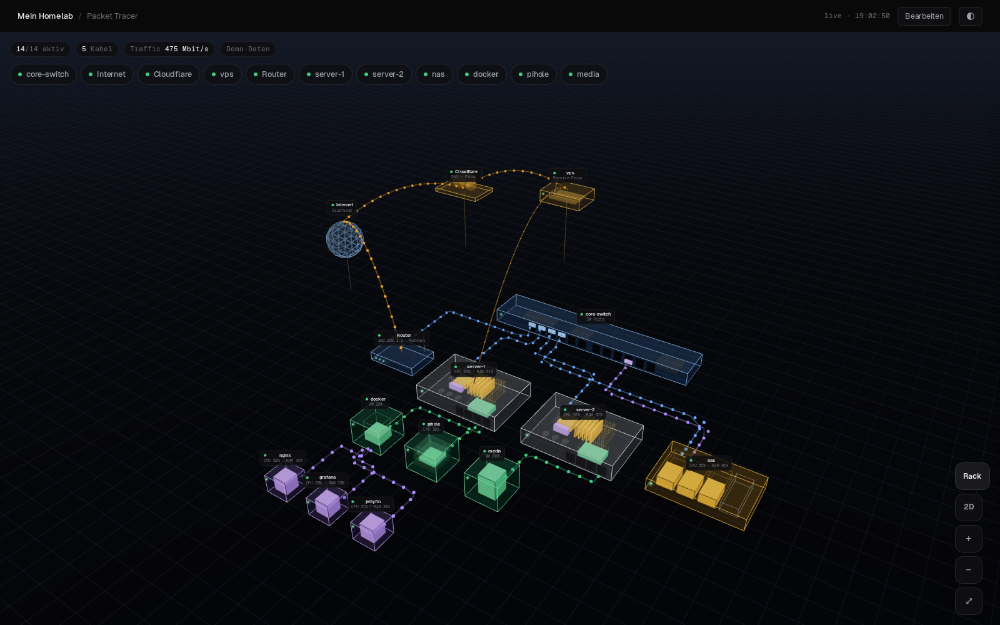
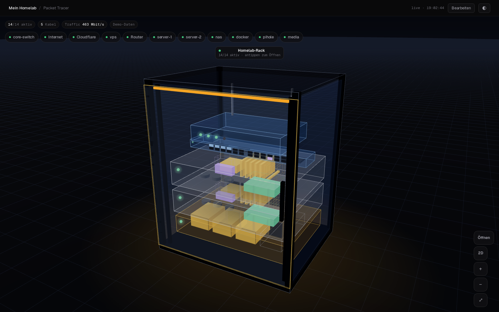
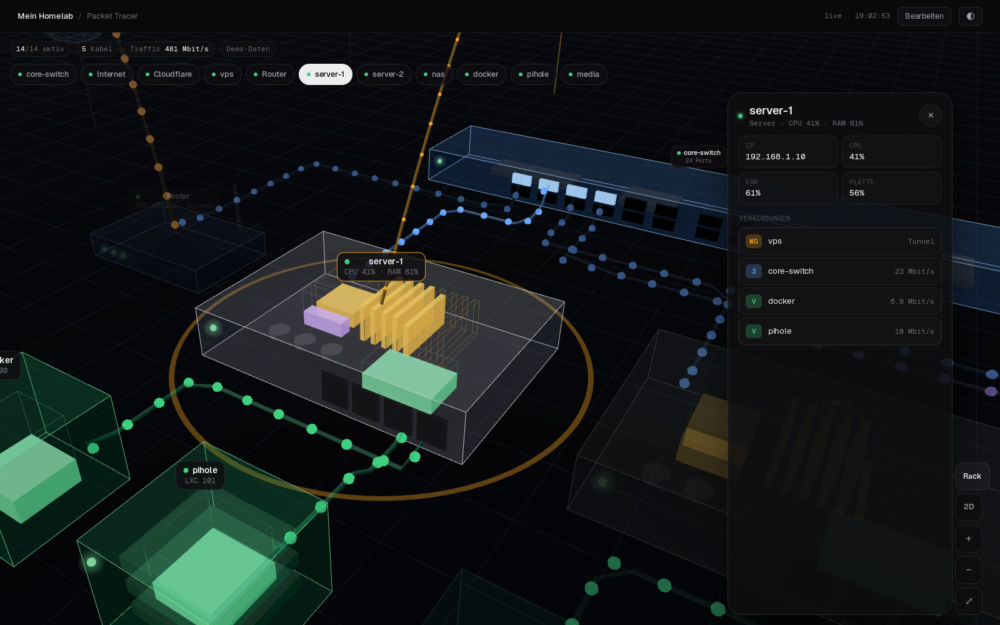
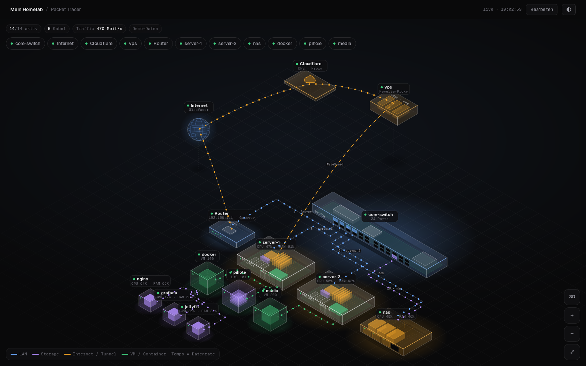
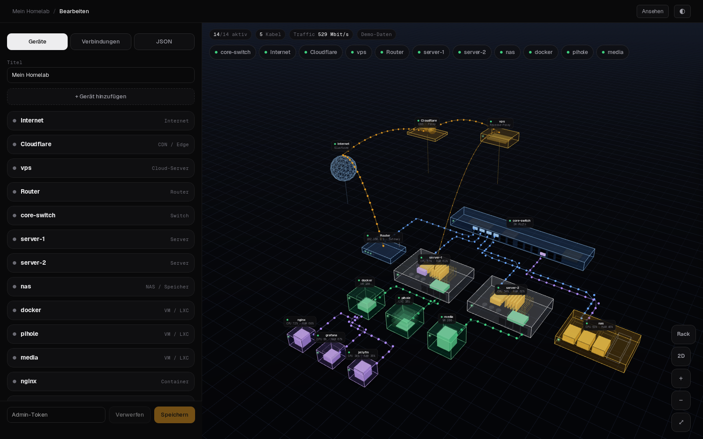
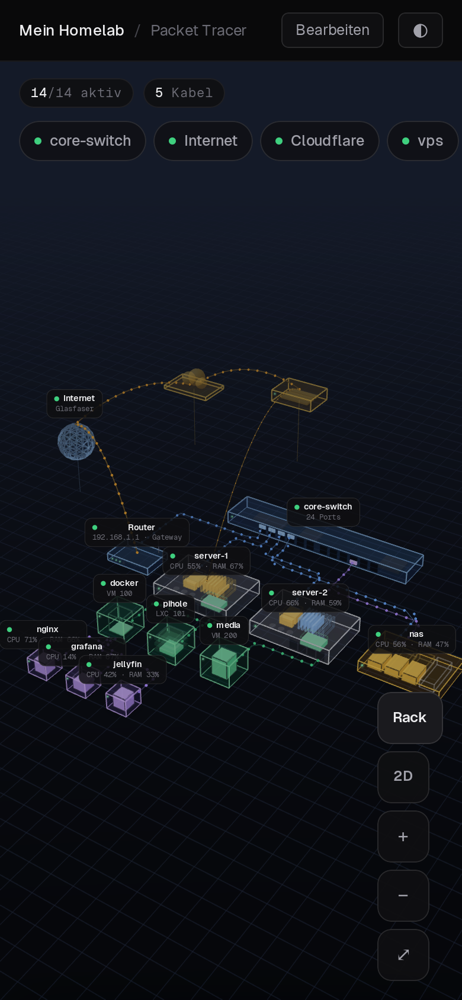

<h1 align="center">Homelab Topologie</h1>

<p align="center">
  Live 3D topology of your homelab — devices, cables and packets in real time.<br>
  A glass rack that unfolds, a browser editor, zero dependencies (just Node.js).
</p>

<p align="center">
  
</p>

## Features

- **3D view (Three.js).** Starts as a glass rack with all hardware inside. Tap it and the
  devices slide out through the door to their place. Drag to orbit, pinch or scroll to zoom,
  double-tap to fly to a device.
- **Live packets.** Every cable carries packets at its current data rate, and switch ports
  light up where something is plugged in.
- **Fill levels.** CPU, RAM and disk blocks inside servers and NAS bays fill up with real usage.
- **Device details.** Tap a device for IP, load, connections and an "Open" button.
- **2D isometric view.** One button away and lighter on old devices.
- **Editor** at `/edit`. Add and remove devices and links in a form with a live preview,
  plus a JSON view for backup and sharing.
- **Health checks.** The server probes `http(s)://` and `tcp://` targets itself.
- **Web app.** Works on phones and has a dark and a light theme. The UI is in German.

## Screenshots

<table>
  <tr>
    <td width="50%"><br><sub><b>Rack</b> — the default view; tap to unfold</sub></td>
    <td width="50%"><br><sub><b>Details</b> — load, IP and every connection with its rate</sub></td>
  </tr>
  <tr>
    <td width="50%"><br><sub><b>2D isometric</b> — port numbers on every cable</sub></td>
    <td width="50%"><br><sub><b>Editor</b> — forms on the left, live preview on the right</sub></td>
  </tr>
</table>

<p align="center">
  <br>
  <sub>On a phone, as a web app</sub>
</p>

## Quick start

```sh
cp .env.example .env
echo "ADMIN_TOKEN=$(openssl rand -hex 24)" >> .env
docker compose up -d --build        # → http://<server>:8080
```

Without Docker: `ADMIN_TOKEN=… node server.js` (Node ≥ 18). Tests: `npm test`.

The topology lives in `data/topology.json`. On the first start you see `topology.example.json`;
saving in the editor creates your own file.

| Variable | Meaning |
|---|---|
| `ADMIN_TOKEN` | allows saving in the editor (and sending metrics). Without it the editor is read-only. |
| `METRICS_TOKEN` | optional: a separate token only for `POST /api/metrics` |
| `DEMO` | `1` (default) = simulated traffic until real metrics arrive; `0` = off |
| `PORT`, `DATA_DIR` | port (8080) and data directory |

> The page itself has no login. Keep it on your LAN/VPN or behind a login proxy
> (e.g. oauth2-proxy, Authelia). The admin token only protects saving.

## Topology format

```json
{
  "title": "My Homelab",
  "devices": [
    { "id": "switch", "kind": "switch", "name": "core-switch", "ports": 24 },
    { "id": "server-1", "kind": "server", "name": "server-1", "ip": "192.168.1.10", "check": "tcp://192.168.1.10:22" },
    { "id": "docker", "kind": "guest", "name": "docker", "host": "server-1" }
  ],
  "links": [
    { "from": "switch", "to": "server-1", "port": 3, "type": "lan" },
    { "from": "server-1", "to": "docker", "type": "vm" }
  ]
}
```

**Devices (`kind`):** `switch` (up to 24 ports + 4 SFP), `router`, `server` (CPU/RAM visible),
`nas` (`disks` 0–4), `guest` (VM; `"lxc": true` for an LXC), `ct` (container), `vps`, `cloud`,
`globe` (internet), `generic`.

Optional fields:
- `ip`, `sub`, `print`: text printed on the device
- `href`: "Open" button
- `check`: `https://…` or `tcp://host:port`
- `info`: `{ "Name": "Value" }`
- `host`: the guest or container runs on this device
- `x`/`y`/`z`: fixed position; otherwise it is laid out automatically

**Links (`type`):**
- `lan`, `sto` (storage), `inet`, `tun` (VPN, dashed), `vm`, `ct`
- `port`: only when `from` is a switch
- `label`: caption
- `id`: used for metrics. Defaults to `<from>--<to>`.

## Sending live data

```sh
curl -X POST http://topologie:8080/api/metrics -H "Authorization: Bearer $TOKEN" -d '{
  "links":   { "switch--server-1": { "rx": 1250000, "tx": 80000 } },
  "devices": { "server-1": { "cpu": 0.42, "mem": 0.61, "disk": 0.35, "load": 0.2, "status": "ok", "sub": "12 VMs" } }
}'
```

- **Units:** `rx` and `tx` in bytes/s; `cpu`, `mem`, `disk` (used storage) and `load` (load per core) from 0 to 1.
  The blocks inside servers and NAS fill up with these values.
- **Status:** `ok`, `warn`, `bad` or `off`.
- **Demo mode** turns off for 60 s as soon as metrics arrive. Links without values then stay quiet.
- **Ready-made example:** [`examples/push-metrics.sh`](examples/push-metrics.sh) reads `/proc/net/dev` for one
  network interface and sends the rate every 5 s:

```sh
URL=http://topologie:8080 TOKEN=… LINK=switch--server-1 IFACE=eth0 DEVICE=server-1 ./examples/push-metrics.sh
```

Any other source works the same way as long as it sends this JSON: SNMP from the switch, the Proxmox API or Prometheus.

## API

| Method | Path | |
|---|---|---|
| GET | `/api/state` | topology + current values |
| PUT | `/api/topology` | save the topology (Bearer `ADMIN_TOKEN`, validated) |
| POST | `/api/metrics` | send values (Bearer `METRICS_TOKEN` or `ADMIN_TOKEN`) |

## License

MIT. The Geist / Geist Mono fonts are under the SIL Open Font License.
